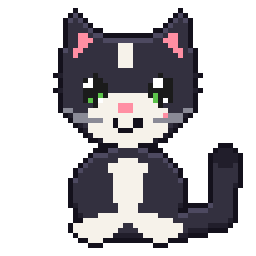

<p align="center"></p>

<h1 align="center">TinyPaws</h1>

<p align="center"><b>Pixel pets for your desktop and your stream.</b><br>
🇬🇧 English · <a href="#-deutsch">🇩🇪 Deutsch (weiter unten)</a></p>

Tiny pixel animals (cat, dog, fox, rabbit, dragon, bird – 4–6 breeds each) that live on your desktop: they walk around,
sleep, jump, climb windows, get up to mischief and react to Twitch chat and stream events. No AI needed,
~2 % CPU, ~145 MB RAM. German and English user interface.

## Quick start (Linux, tested on CachyOS/KDE)

```bash
sudo pacman -S pyside6     # if not installed yet
./install.sh               # app menu entry
python3 -m tinypaws --panel
```

- First start: setup wizard (name, pixel size, FPS, random activity, language, monitor, autostart, poems).
- **Left mouse button on the pet**: drag and drop it. **Double-click**: meow. **Right-click**: menu.
- Everywhere else your clicks go straight through to your windows.
- **Start window** (click the tray icon or launch TinyPaws again): big **Connect Twitch** and **Add to OBS** buttons, pet choice, test panel, settings.
- **Sounds**: Settings → “Sounds” (off by default) and volume. All sounds are synthesised by TinyPaws itself. OBS picks them up through normal desktop audio capture; the browser source itself is silent.
- **Several pets**: in the start window under “Companions” add up to 3 more pets, switch each on/off or remove it. They follow each other, play ball and sleep side by side.
- **Size**: Settings → “Pixel size” or “Fit size to the screen automatically” (adapts when the monitor or resolution changes; off = your size stays). HiDPI (125–200 %) stays crisp.
- **Several monitors**: Settings → “Wander between monitors” – now and then the pet walks over the screen edge onto the neighbouring monitor.
- **Change pet**: tray menu or right-click the pet → “Choose pet” (instantly, no restart), or at the top of the test panel.
- Tray icon: test panel, meme scenes, interaction on/off, settings, quit.
- `--panel` opens the test panel, `--reset` runs the setup wizard again.
- Settings: `~/.config/tinypaws/settings.json`, autostart: `~/.config/autostart/tinypaws.desktop`.

## Installation

**Downloads (latest version):** [All releases](https://github.com/DeadlySinFredo/TinyPaws/releases) · [Latest release](https://github.com/DeadlySinFredo/TinyPaws/releases/latest)

| System | Download | How |
|---|---|---|
| **CachyOS / Arch** | – | `cd packaging/arch && makepkg -si` (builds from this repo). Then “TinyPaws” in the app menu or `tinypaws`. |
| **Linux (other)** | [TinyPaws-linux-x86_64.tar.gz](https://github.com/DeadlySinFredo/TinyPaws/releases/latest/download/TinyPaws-linux-x86_64.tar.gz) | Unpack, run `TinyPaws/TinyPaws`. |
| **Windows 10/11** | [TinyPaws-windows-x86_64.zip](https://github.com/DeadlySinFredo/TinyPaws/releases/latest/download/TinyPaws-windows-x86_64.zip) | Unpack, run `TinyPaws.exe`. Unsigned: SmartScreen → “More info” → “Run anyway”. |
| **macOS (Apple Silicon)** | [TinyPaws-macos-arm64.zip](https://github.com/DeadlySinFredo/TinyPaws/releases/latest/download/TinyPaws-macos-arm64.zip) | Unpack, right-click `TinyPaws.app` → “Open” (unsigned). Lives in the menu bar, no Dock icon. |

Builds run automatically on every push (GitHub Actions); a `v*` tag creates a release with all three packages.

## Test panel

Every action, the three meme scenes (**Hype Train** with levels 1–10, **GigaChad**, **Absolute Cinema**),
simulated stream events (follow/sub/raid) and a chat simulator – no streaming platform needed.

## Window climbing (KDE Plasma)

Now and then the pet climbs up a window and naps on top of it. For that TinyPaws loads a small KWin script at
start-up (only while the app runs). Can be switched off in the settings.

## Your own pets

Tray menu → “Export pet as template…”, repaint the sprite sheet, “Import pet pack…”.
Format and rules: [docs/PET_PACKS.md](docs/PET_PACKS.md).

## OBS

Tray menu → **“Copy OBS link”** (switches the source on if needed). In OBS: add a **Browser** source, paste the link,
width/height = your screen resolution (without the taskbar). The background is transparent and everything stays in
sync with the desktop pet. The server only listens on localhost. Pet switches and app restarts are picked up by the
open source automatically (no “Refresh” in OBS needed).

## Twitch

Settings → “Twitch channel (read-only)” → enter the channel name. Anonymous read access via Twitch IRC,
**no login, no token**. Recognised: chat, subs/resubs, gift subs, bits, raids. Automatic reconnect with back-off.

**Real Hype Train + follows (Twitch login, one-time setup):**

1. <https://dev.twitch.tv/console/apps> → “Register your application” (TinyPaws opens it for you): name e.g. `TinyPaws-<your name>`,
   OAuth redirect `http://localhost`, category “Other”, client type **Public**.
2. Tray menu → **“Connect Twitch”**: the first time, the Twitch developer page opens together with a window where you
   paste the **Client ID**. TinyPaws then shows a code and opens twitch.tv/activate – confirm it there. No password ever
   goes through TinyPaws. Your channel’s chat is connected automatically as well.

The access token is then kept in the system keyring (Linux: Secret Service/KWallet, macOS: Keychain,
Windows: Credential Manager), never in a file. Hype Train (start, level-up, end), follows, subs, gift subs, bits and
raids then arrive via Twitch EventSub; disconnect from the tray menu.

## Chat reactions

Rules in [`tinypaws/reactions.json`](tinypaws/reactions.json): regex patterns, chance, cooldown, priority, action.
New reactions = a new JSON entry, no code.

## Tests

```bash
python3 -m unittest discover -s tests -t .
python3 scripts/render_preview.py preview.png   # render scenes off-screen as PNG
```

See [ARCHITECTURE.md](ARCHITECTURE.md), [ROADMAP.md](ROADMAP.md), [DEVELOPMENT_STATUS.md](DEVELOPMENT_STATUS.md).

## License

MIT – see [LICENSE](LICENSE). All graphics, texts and poems are original work.

---

<a id="deutsch"></a>

# 🇩🇪 Deutsch

Kleine Pixel-Tiere (Katze, Hund, Fuchs, Hase, Drache, Vogel – je 4–6 Rassen), die auf deinem Desktop leben – laufen herum, schlafen, springen, machen Unsinn
und reagieren auf Twitch-Chat und Stream-Ereignisse. Ohne KI, ~2 % CPU, ~145 MB RAM. Oberfläche Deutsch/Englisch.

### Schnellstart (Linux, CachyOS/KDE getestet)

```bash
sudo pacman -S pyside6     # falls nicht vorhanden
./install.sh               # Menüeintrag
python3 -m tinypaws --panel
```

- Erster Start: Einrichtungsassistent (Name, Pixel-Größe, FPS, Zufallsaktivität, Sprache, Monitor, Autostart, Gedichte).
- **Linke Maustaste auf der Katze**: ziehen und fallen lassen. **Doppelklick**: Miau. **Rechtsklick**: Menü.
- Überall sonst gehen Klicks durch zu deinen Fenstern.
- **Startfenster** (Klick aufs Tray-Symbol oder TinyPaws erneut starten): große Knöpfe **Mit Twitch verbinden** und **In OBS einbinden**, Tierauswahl, Testpanel, Einstellungen.
- **Töne**: Einstellungen → „Töne“ (standardmäßig aus) und Lautstärke. Alle Töne sind selbst erzeugt. In OBS kommen sie über die normale Desktop-Audio-Aufnahme an; die Browserquelle selbst ist stumm.
- **Mehrere Tiere**: im Startfenster unter „Begleiter“ bis zu 3 weitere Tiere hinzufügen, einzeln an/aus schalten oder entfernen. Sie laufen einander hinterher, spielen Ball und schlafen nebeneinander.
- **Größe**: Einstellungen → „Pixel-Größe“ oder „Größe automatisch an Bildschirm anpassen“ (passt sich bei Monitor-/Auflösungswechsel an; aus = deine Größe bleibt). HiDPI (125–200 %) wird scharf dargestellt.
- **Mehrere Monitore**: Einstellungen → „Zwischen Monitoren wandern“ – das Tier läuft ab und zu über die Bildschirmkante auf den Nachbarmonitor.
- **Tier wechseln**: Tray-Menü oder Rechtsklick auf das Tier → „Tier wählen“ (sofort, ohne Neustart), oder oben im Testpanel.
- Tray-Icon: Testpanel, Meme-Szenen, Interaktion an/aus, Einstellungen, Beenden.
- `--panel` öffnet das Testpanel, `--reset` startet den Assistenten neu.
- Einstellungen: `~/.config/tinypaws/settings.json`, Autostart: `~/.config/autostart/tinypaws.desktop`.

### Installation

**Downloads (neueste Version):** [Alle Releases](https://github.com/DeadlySinFredo/TinyPaws/releases) · [Neuestes Release](https://github.com/DeadlySinFredo/TinyPaws/releases/latest)

| System | Download | Weg |
|---|---|---|
| **CachyOS / Arch** | – | `cd packaging/arch && makepkg -si` (baut aus diesem Repo). Danach im Startmenü „TinyPaws“ oder `tinypaws`. |
| **Linux (andere)** | [TinyPaws-linux-x86_64.tar.gz](https://github.com/DeadlySinFredo/TinyPaws/releases/latest/download/TinyPaws-linux-x86_64.tar.gz) | Entpacken, `TinyPaws/TinyPaws` starten. |
| **Windows 10/11** | [TinyPaws-windows-x86_64.zip](https://github.com/DeadlySinFredo/TinyPaws/releases/latest/download/TinyPaws-windows-x86_64.zip) | Entpacken, `TinyPaws.exe` starten. Unsigniert: SmartScreen → „Weitere Informationen“ → „Trotzdem ausführen“. |
| **macOS (Apple Silicon)** | [TinyPaws-macos-arm64.zip](https://github.com/DeadlySinFredo/TinyPaws/releases/latest/download/TinyPaws-macos-arm64.zip) | Entpacken, `TinyPaws.app` per Rechtsklick → „Öffnen“ (unsigniert). Lebt im Tray, kein Dock-Symbol. |

Builds entstehen automatisch bei jedem Push (GitHub Actions, Reiter „Actions“ → Artefakte);
ein Tag `v*` erzeugt ein Release mit allen drei Paketen.

### Testpanel

Alle Aktionen, die drei Meme-Szenen (**Hype Train** mit Level 1–10, **GigaChad**, **Absolute Cinema**),
simulierte Stream-Events (Follow/Abo/Raid) und eine Chat-Simulation – ohne Streaming-Plattform.

### Fenster klettern (KDE Plasma)

Das Tier klettert ab und zu an Fenstern hoch und schläft oben drauf. Dafür lädt TinyPaws beim Start
ein kleines KWin-Skript (nur solange die App läuft). Abschaltbar in den Einstellungen.

### Eigene Tiere

Tray-Menü → „Tier als Vorlage exportieren…“, Spritesheet umzeichnen, „Tierpaket importieren…“.
Format und Regeln: [docs/PET_PACKS.md](docs/PET_PACKS.md).

### OBS

Tray-Menü → **„OBS-Link kopieren“** (schaltet die Quelle bei Bedarf ein). In OBS: Quelle **Browser**, Link einfügen,
Breite/Höhe = deine Bildschirmauflösung (ohne Taskleiste). Hintergrund ist transparent, alles läuft synchron
zur Desktop-Katze. Server lauscht nur auf localhost. Tierwechsel und App-Neustarts übernimmt die geöffnete
Quelle von selbst (kein „Aktualisieren“ in OBS nötig).

### Twitch

Einstellungen → „Twitch-Kanal (nur lesen)“ → Kanalname eintragen. Anonymer Lesezugang über Twitch-IRC,
**kein Login, kein Token**. Erkannt: Chat, Abos/Resubs, Geschenk-Abos, Bits, Raids. Automatischer
Reconnect mit Backoff.

**Echter Hype Train + Follows (Twitch-Login, einmalig einrichten):**

1. <https://dev.twitch.tv/console/apps> → „Anwendung registrieren“ (öffnet TinyPaws auch selbst): Name z. B. `TinyPaws-<dein Name>`,
   OAuth-Redirect `http://localhost`, Kategorie „Other“, Client-Typ **Öffentlich**.
2. Tray-Menü → **„Mit Twitch verbinden“**: beim ersten Mal öffnet sich die Twitch-Entwicklerseite und ein
   Fenster, in das du die **Client-ID** einfügst. Danach zeigt TinyPaws einen Code und öffnet
   twitch.tv/activate – dort bestätigen. Kein Passwort geht durch TinyPaws. Der Chat deines Kanals wird
   automatisch mit verbunden.

Der Zugangsschlüssel liegt danach im System-Schlüsselbund (Linux: Secret Service/KWallet, macOS: Schlüsselbund,
Windows: Anmeldeinformationsverwaltung),
nicht in einer Datei. Dann kommen Hype Train (Start, Level-Up, Ende), Follows, Abos, Geschenk-Abos,
Bits und Raids über Twitch EventSub; Abmelden über das Tray-Menü.

### Chat-Reaktionen

Regeln in [`tinypaws/reactions.json`](tinypaws/reactions.json): Regex-Muster, Chance, Cooldown,
Priorität, Aktion. Neue Reaktionen = neuer JSON-Eintrag, kein Code.

### Tests

```bash
python3 -m unittest discover -s tests -t .
python3 scripts/render_preview.py preview.png   # Szenen offscreen als PNG rendern
```

Siehe [ARCHITECTURE.md](ARCHITECTURE.md), [ROADMAP.md](ROADMAP.md), [DEVELOPMENT_STATUS.md](DEVELOPMENT_STATUS.md).

### Lizenz

MIT – siehe [LICENSE](LICENSE). Alle Grafiken, Texte und Gedichte sind eigene Werke.
